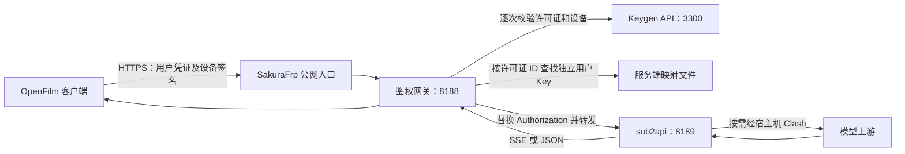

# OpenFilm、Keygen 与 sub2api 的关系

OpenFilm 是用户使用的桌面剪辑客户端；Keygen 管理激活码、授权有效期和设备绑定；sub2api 管理模型上游、每用户独立 API Key、用量与额度。鉴权网关把三者连接起来。开发环境与正式交付版本都通过激活码使用服务，没有管理员直连模式。

## 职责划分

| 组件 | 负责什么 | 保存什么 |
| --- | --- | --- |
| OpenFilm 客户端 | 激活设备、自动续期、给模型请求签名、执行本地剪辑工具 | 系统安全存储加密的设备私钥和续期凭据；公共服务地址和模型名称 |
| Keygen CE API / Worker | 创建许可证、验证激活码、限制设备数量、授权到期或停用、设备解绑 | 许可证、策略、设备公钥指纹等授权数据 |
| 鉴权网关 | 验证设备签名和授权、阻止重放、找到用户对应的 sub2api Key、流式转发 | 服务端签名密钥、Keygen 服务端 Token、许可证 ID 到 sub2api Key 的映射 |
| sub2api | 使用上游账号或密钥请求模型，按独立用户 Key 计量和限制额度 | 上游凭据、用户 Key、用量和额度配置 |
| 中文授权管理页 | 发码并关联 Key，替换映射、解绑设备、停用和恢复授权 | 用户备注及映射写入服务端文件 |
| Keygen Portal | 完整的产品、策略、许可证与设备管理 | 通过 Keygen API 管理，不维护 sub2api Key 映射 |

Keygen 不代理模型请求、不管理模型用量。sub2api 不负责 OpenFilm 的设备激活。客户端不获取 sub2api Key，也不持有 Keygen 管理员凭据。

## 请求链路



只有网关的 8188 端口经过公网隧道。当前公网 API 地址是 `https://api.u4178022.nyat.app:13547/v1`。Keygen、sub2api 以及管理页面只提供本机或内部访问。公网域名保持不变，8188 的服务已由 sub2api 切换成鉴权网关。

模型请求的正文基本保持原样，工具定义、工具结果和 SSE 事件均透传。网关把用户短期凭证换成对应用户的 sub2api Key。客户端取消请求时会中止上游转发。用户的用量与额度继续由 sub2api 管理，网关不重复实现计费。

## 用户如何使用

1. 管理员在 sub2api 为用户创建独立 Key，并设置额度。
2. 在中文管理页面创建许可证并关联这个 Key，获得激活码。
3. 用户在 OpenFilm 的“激活”窗口输入激活码。服务端绑定当前安装生成的设备公钥指纹。
4. 客户端加密保存设备私钥和续期凭据。之后启动软件、发起请求、短期凭证续期均无需重复输入激活码。
5. 网关每次请求都校验 Keygen 授权，所以停用许可证、删除映射或解绑设备后，旧凭证不能继续发起模型请求。

当前短期访问凭证有效期五分钟，续期凭据最长一年。续期凭据到期、重装系统导致设备凭据丢失、设备解绑或授权被撤销时可能需要重新激活。授权到期或被撤销时不能靠重新输入原码绕过。

当前客户端没有自助解绑功能。换机时由管理员通过中文管理页或 Keygen Portal 解绑旧设备，再在新设备输入原激活码。仅复制安装包或续期凭据不能直接通过另一设备的签名校验；控制已授权设备的人仍可能提取解密后的设备密钥或转发请求，不能保证绝对防破解。

## 客户端授权流程

启动时必须在线验证设备授权。未激活、授权失效或无法验证时，只显示无法关闭的激活弹窗，编辑器与聊天界面不会挂载；主进程同时拒绝业务 IPC，菜单仅保留复制、粘贴和退出。每分钟以及窗口重新获得焦点时复查授权，验证失败则重新锁定。正常授权续期无需重复输入激活码。

客户端界面只保留激活码、激活状态和测试连接，不再提供原始 API Key、管理员直连、服务地址或模型编辑入口。主进程也没有从旧 Key 文件或 `OPENFILM_SUB2API_API_KEY` 回退直连的逻辑。

主进程的公共服务配置是 `gatewayEndpoint()`，默认使用上述固定公网地址及 `gpt-6.1-sol`。需要连接另一套网关时，可在启动客户端前设置：

```text
OPENFILM_GATEWAY_BASE_URL=http://127.0.0.1:8188/v1
OPENFILM_GATEWAY_MODEL=gpt-6.1-sol
```

这两个配置不包含密钥，也不绕过激活。非本机地址必须使用 HTTPS，地址必须以 `/v1` 结尾。

成功激活后客户端保存 `gateway-device.json` 与 `gateway-session.json`，私钥及续期凭据优先通过 Electron safeStorage 加密。Linux/WSL 无可用系统密钥环时改用 AES-256-GCM，本地随机密钥 gateway-storage.key 以 0600 权限保存到应用数据目录；不使用 basic_text，也不改写或绕过服务器授权。备份此类授权时需同时保留该密钥文件；已有系统加密凭据仍需原系统密钥环。旧 `sub2api.json` 不再作为授权依据，并在成功激活后删除。Codex 子进程只拿到本机临时请求桥的地址与随机 Token，设备私钥不传入模型或剪辑工具。

Windows 使用系统内置 DPAPI，无需额外安装密钥环；macOS 使用系统 Keychain。Linux/WSL 需要已安装并解锁的 GNOME Keyring 或 KWallet；不接受 `basic_text` 弱加密后端。平台存储方式不同，设备激活与授权检查规则一致。

所有使用者都通过同样的激活码流程授权。应给每个用户建立独立 sub2api Key 与独立许可证；多个许可证指向同一个 Key 会共用该 Key 的额度。激活码不写入源码、文档或安装包。

## 服务与数据

当前是多个容器部署，不是单一全量镜像：Keygen API、Worker、PostgreSQL、Redis；sub2api 应用、PostgreSQL、Redis；鉴权网关、中文管理页、Portal 静态代理。Clash 和 SakuraFrp 为宿主机程序。

程序镜像与业务数据分开。数据库通过 Docker 数据卷持久化；授权映射、服务端签名密钥、数据库密码和加密密钥保存在服务端配置与数据目录中。重建容器仍需挂载原数据，不能重新生成加密密钥替换原值。

本机管理入口：

| 页面 | 地址 | 用途 |
| --- | --- | --- |
| 中文授权管理 | `http://127.0.0.1:8790` | 发码、用户备注、Key 映射、解绑、停用/恢复 |
| Keygen Portal | `http://127.0.0.1:8791` | 产品、策略、许可证、设备管理 |
| sub2api 后台 | `http://127.0.0.1:8189` | 上游账号、用户 Key、用量和额度 |

部署、启动、备份所需文件及管理脚本参见 [鉴权网关部署说明](../services/auth-gateway/README.md)。管理员密码、激活码、用户 Key、上游凭据都不得提交到 Git。
